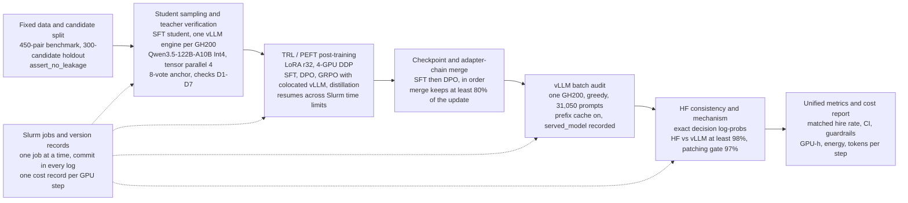

# System overview: the post-training and audit pipeline on Alps

The infrastructure half of the GTC 2027 poster, as built and run, not as planned. One figure,
and beside each stage the resources it ran on, the check that gates it and what it leaves on
disk. A reader should be able to answer three questions from it: which model was trained,
which weights were evaluated, and how a result maps to its cost. Every entry names the file or
job it comes from; paths are relative to the repository, `$XW` is `/ritom/scratch/cscs/zhang/xw`.

## The stages

| Stage | Resources | Gate | Leaves | Source |
|---|---|---|---|---|
| Data and split | CPU | `assert_no_leakage` raises on any held-out candidate or job; train/validation split by candidate (5%, seed 42) | `data/benchmark/holdout_ids.json` (300 candidates, 301 jobs, 900 pairs, both languages); EN benchmark 450 pairs, 150 candidates, 171 jobs | `data/benchmark.py` `write_holdout`, `assert_no_leakage`; `generation/dataset.py` `train_val_split`; README |
| Student sampling | 1 node, 4 GH200, one sampling process per GPU; vLLM `gpu_memory_utilization` 0.70, 256 sequences, T = 1.0, 8 samples per prompt, 512-prompt chunks so a cut job resumes | D1-D7 data checks; D4 reads the student through HF+PEFT, never vLLM's LoRA path | `artifacts/semisynthetic-v3/...`, per-source `dpo_v3_checks/<source>/direction_report.{json,md}` | `scripts/cscs/onpolicy_full.sbatch`; `configs/generation/negatives_v3_onpolicy_full_gh200.yaml`; `generation/direction_check.py`; `docs/V3_NEW_DATA.md` (jobs 5110942, 5111654) |
| Teacher | Qwen/Qwen3.5-122B-A10B-GPTQ-Int4, tensor parallel 4 on one node, `gpu_memory_utilization` 0.80, T = 0 when judging | 8-draw majority vote per prompt (`VOTE_DRAWS = 8`), unstable prompts dropped above 5/8 | vote anchors and judged pairs under `artifacts/semisynthetic-v3/` | same config; `generation/vote.py`; `docs/V3_NEW_DATA.md` |
| Post-training | 1 node, `torch.distributed.run --nproc_per_node=4` (DDP), LoRA r32/α64, bf16. SFT-v3: batch 1 x accum 4 per GPU. DPO_V3_4880: batch 1 x accum 4, β 0.3, sigmoid + 0.2 SFT loss. GRPO-v3-all: 16 rollouts per prompt from a vLLM engine colocated on each GPU (0.30 of memory), 8 x 8 per GPU, 256 completions per step, weights synced to vLLM in fp32 | resume from the newest checkpoint with a `trainer_state.json`, so a job cut at its time limit continues; GRPO: sync check on 256 rows every 50 steps, hire-rate band 0.15-0.35 | `$XW/outputs/<stage>/<run>/checkpoint-N` and `run_config.json` (parent adapter in `sft_checkpoint`) | `scripts/cscs/train_{sft,dpo,grpo,distill}.sbatch`; `mitigation/training_common.py` `last_checkpoint`; the v3 configs under `configs/mitigation/` |
| Merge | CPU, bf16 base | adapter chain read from `run_config.json` and merged in order (SFT, then DPO); the share of each update the merge kept is measured in fp32; the standard requires at least 80% (DPO_V3_4880 95.85%, GRPO-v3-all 97.71%) | `$XW/outputs/merged/<run>--checkpoint-N` with `merged_from.json` (adapters, mtime, retention) | `mitigation/merge.py`; `analysis/eval_standard.py` `min_merge_kept_pct`; `reports/reference_metrics.csv` |
| Audit | `scripts/cscs/evaluate_arm.sbatch` on one 4-GPU node: GPU 0 the audit, GPU 1 the arm's margins, GPU 2 HF validation, GPU 3 the base's margins. vLLM 0.31.0, greedy, 31,050 prompts, prefix cache on, 4,000-prompt chunks cached for resume. DPO_V3_4880 (job 5119349): 688.7 s generation, 116.4 s load, 0.233 GPU-h | parse-failure abort threshold; the run's `served_model` is the merged directory | `$XW/outputs/raw/<run>.parquet` and `.meta.json` | `eval/runner.py`, `eval/backends.py`; cost record `cost/records/20261022T102607_eval_audit_5119349_34600.json`; `docs/THROUGHPUT_B.md` |
| HF consistency and mechanism | the margins and validation GPUs of the same job; activation patching on 4 GPUs (`interp.sbatch`) | decision margin = log p(hire) − log p(reject) of the first decision token, read exactly from vLLM; HF vs vLLM agreement and rank correlation at least 0.98; patching starts only at ≥ 97% full-grid agreement (measured 99.23-99.67%) | `reports/operating_point/v2/`, `reports/interp/` | `scripts/operating_point_control.py`; `scripts/diagnose_adapter.py`; `docs/DISTILL_PATCHING.md`, `docs/RL_PATCHING.md` |
| Metrics and cost | CPU | change in unstable sets at matched hire rate, 95% CI over candidates (1,000 resamples), better only if the upper bound is below 0; guardrails: TPR drop ≤ 10 pp, agreement drop ≤ 5 pp, undecided ≤ 1%, merge kept ≥ 80% | `reports/reference_metrics.csv`, `reports/comparisons.csv`; `reports/cost/{steps,checkpoints,throughput}.csv` | `docs/EVAL_STANDARD.md`, `analysis/eval_standard.py`; `utils/cost.py`, `scripts/cost_report.py`, `docs/COST.md` |
| Slurm and versions | account lp193, one job at a time on the shared account | every sbatch log starts with host, job and commit (`throughput_b*.sbatch` also hash each uncommitted file); every GPU step is wrapped in `cost <stage> <label>` | per-step JSON in `$XW/cost/records/`: Slurm job, GPUs actually used (NVML), GPU-h, energy, utilisation, peak memory, commit, branch, dirty flag, library versions, requests and tokens, `served_model` | `scripts/cscs/env.sh`; `utils/cost.py` |

## Which model, which weights, which cost

- **Trained.** A run's `run_config.json` names its parent: DPO_V3_4880 is
  `outputs/dpo/qwen3.5-9b_en_only_dpo_v3_4880/checkpoint-305`, trained from SFT-v3. The step
  audited is declared before training (`docs/V3_NEW_DATA.md`, round 3).
- **Evaluated.** The audit config's `lora_path` fixes the checkpoint and the run name
  (`..._step305`). The merge writes `outputs/merged/qwen3.5-9b_en_only_dpo_v3_4880--checkpoint-305`,
  and the audit's `meta.json` records it as `served_model`. vLLM never serves the adapter
  directly, because its LoRA path does not reproduce Qwen3.5 adapters.
- **Cost.** Every GPU step's record carries `arm` (`HBM_COST_ARM` at submission), `run_name`
  and `served_model`. `scripts/cost_report.py` turns the records into `steps.csv` (per step),
  arm totals and `checkpoints.csv` (cost up to each saved checkpoint, keyed by output directory
  and step). An audited checkpoint is paired with its `checkpoints.csv` row, not with the arm
  total, because arm rows overlap.

## Caveats

- `reports/cost/` on main was last regenerated with job 5106727 (2026-10-20). The v3 arms'
  costs exist in `$XW/cost/records/` and are quoted in the docs, and `checkpoints.csv` is empty
  until `scripts/cost_report.py` is run again. Regenerate before taking any cost onto the poster.
- The merge itself is in bf16. Only the retention measurement and GRPO's weight sync are in fp32.
  A small update can be partly lost in the merge, which is why the standard gates on it.
- One node, 4 GH200 per job throughout. Nothing here is multi-node.
