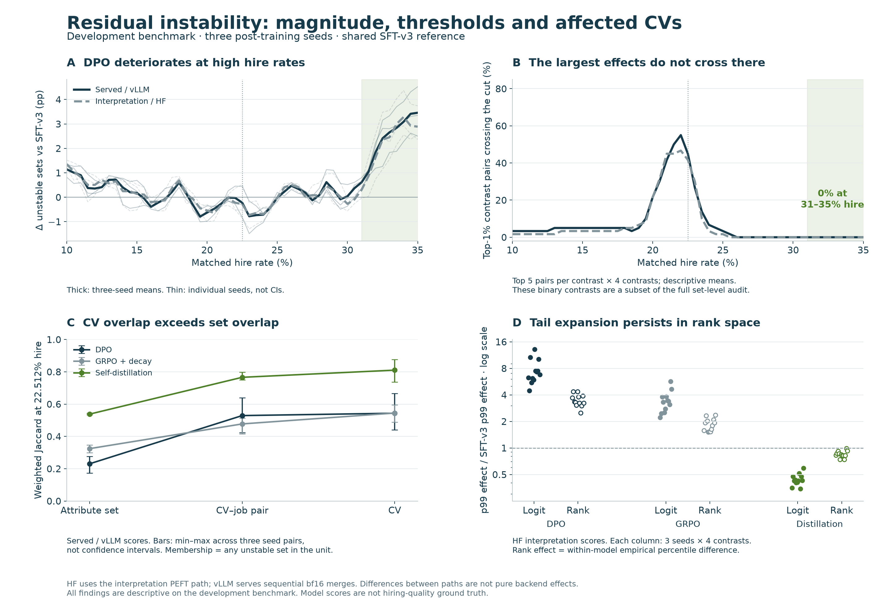

# Research follow-up, 2026-11-02

The completed CPU analyses reuse existing benchmark scores and intervention
artifacts. The final-adapter merge comparison is new inference, with frozen
checkpoints and no training. See the execution record in
[`docs/RESEARCH_FOLLOWUP_20261102.md`](../../docs/RESEARCH_FOLLOWUP_20261102.md).

## Completed CPU findings

1. **Tail expansion survives rank normalization.** Across three seeds and four
   contrasts, DPO's HF p99 absolute logit-effect ratio to SFT-v3 is 4.46–13.20;
   its empirical-percentile effect ratio is 2.49–4.37. GRPO's corresponding
   ranges are 2.21–5.70 and 1.52–2.37. A strictly increasing rescaling of all SFT
   scores, preserving ties, cannot by itself produce these rank-effect changes.

2. **The most extreme contrast pairs do not explain DPO's high-rate decline.**
   In each seed, each of four contrasts contributes five top-1% pairs. None of
   those observations crosses the decision cut at any of the nine 31–35% hire
   points, in either execution path. At 22.512% hire, 4–13 of the 20 HF observations
   and 7–11 of the 20 vLLM observations cross. These are repeated contrast-pair
   observations, not 20 independent people. The full 2,700-set audit still shows
   vLLM DPO deterioration at all 27 seed-by-high-rate points. Effect magnitude
   and distance from the cut must be interpreted together.

3. **Affected people overlap more than unstable attribute sets.** At the common
   hire count, vLLM set/CV Jaccard ranges are 0.17–0.28 / 0.44–0.67 for DPO,
   0.30–0.35 / 0.49–0.60 for GRPO, and 0.53–0.54 / 0.74–0.88 for distillation.
   The same CV may recur under different jobs or attribute groups. The 35 old
   borderline pairs represent 33 CVs and 33 jobs; their concentration near SFT's
   original cut does not generalize to every hire rate.

4. **Tail directions replicate across the completed seeds.** Every one of the
   12 seed-by-contrast cells for both DPO and GRPO has p50 below SFT and p99
   above SFT. Distillation has both below SFT in all 12 cells. The real component
   profile correlations span 0.652–0.889, 0.872–0.972 and 0.908–0.979 respectively.
   DPO combat/implicit L23.H1 ranks 1/46, 2/47 and 2/44 among tested heads, rather
   than first in every seed. Tested-head subsets differ between runs.

The mechanism audit also found a cross-pass baseline discrepancy, including
fresh caches. The largest endpoint difference is 15.69 logits, though medians
are much smaller. Selected token IDs match a fresh rendering exactly, and
final-prenorm replacement controls reproduce their B baselines exactly. The
subsequent targeted GPU replay reproduced each recorded batch baseline exactly.
Within each batch context, two counterordered repetitions were also identical;
between the full-pass and patching batches, the maximum endpoint difference
remained 15.69 logits. One of the eight deliberately selected pairs changed its
zero-threshold crossing status. This reproduces a batch-context dependence on
that diagnostic subset; it neither estimates population prevalence nor isolates
the responsible kernel. The full diagnostic is under
[`mechanism_seeds/batch_diagnostic/`](mechanism_seeds/batch_diagnostic/).

## Inference status and locations

The successful pilot uses 12 complete CV–job pairs per arm. The reconstructed
SFT and final weights match the saved weights bit-for-bit, and reconstructed
versus saved-model pilot scores match exactly in both readouts. This passes the
reconstruction gate; it is not an estimate of full-benchmark merge effects.

The active attempt is selected by
[`merge_precision/active_source.json`](merge_precision/active_source.json).
Job submissions, explicit wall limits and attempt history are under
[`merge_precision/submissions/`](merge_precision/submissions/).

The full jobs are 5241383 for seed 42, 5241378 for seed 43, and 5241379 for seed 44.
Each has a two-hour limit. They were running when this CPU/diagnostic report was
published; full merge-effect estimates are not yet available in this snapshot.

Each full seed job scores full-r32, window-r32 and window-r163 in parallel,
unmerged and bf16 merged, on 31,050 prompts per condition. When all nine arms
finish, the last seed job invokes
`scripts/summarize_adapter_merge_effect.py --when-ready`. It produces paired
candidate-bootstrap comparisons and 51-point curves under the active attempt's
`aggregate/` directory. `pending.json` reports absent arms; only a validated
`summary.json` with `complete:true` denotes a completed aggregate.

## Scope and files

The HF interpretation path activates SFT and final PEFT adapters on the original
base. vLLM serves sequential bf16 merges. Those two existing paths differ in
representation as well as backend. The new merge experiment instead fixes the
already-merged SFT base and changes only the final adapter's execution path.
Its workers use the original Python environment without the optional FLA path.
The isolated batch diagnostic uses the original interpretation environment with
FLA 0.6.0 and no causal_conv1d. These are two distinct controlled comparisons,
not one pooled kernel/representation experiment.

Every path calibrates its own numerical thresholds; the shared target count is
6,990/31,050. The common-rate overlap is descriptive weighted Jaccard. Fixed-cut
leave-one-CV/job-out analysis is an influence check, not held-out evaluation.
All results concern one development benchmark and one shared SFT checkpoint.
No score establishes whether a hiring decision is correct.

- [`decision_geometry/README.md`](decision_geometry/README.md): definitions,
  full-grid curves, tail crossings, affected units and deletion influence.
- [`mechanism_seeds/README.md`](mechanism_seeds/README.md): three-seed real
  interventions, verified-head rankings, tails and historical-cache limitations.
- [`merge_precision/`](merge_precision/): pilot, full inference, provenance,
  Slurm ledgers and automatic aggregate outputs when ready.

Raw CV, job-description and prompt text are excluded from reports. Numeric
per-unit tables use hashed IDs for linkage; this is not a claim of irreversible
anonymization. Source hashes and reproducible commands are in each subreport.
